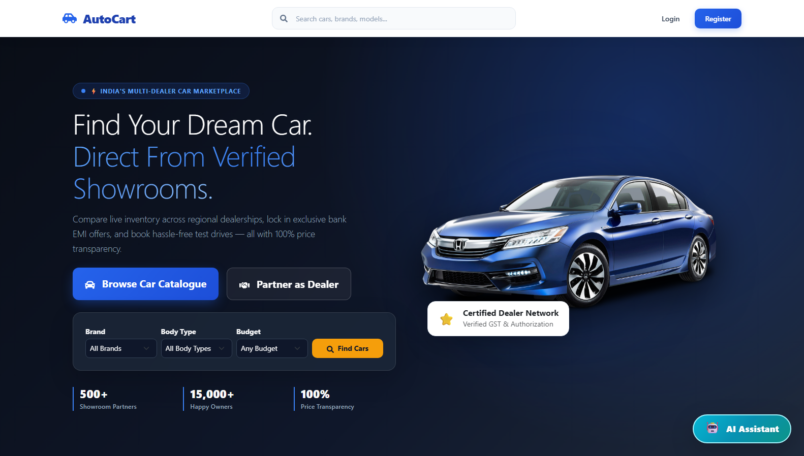
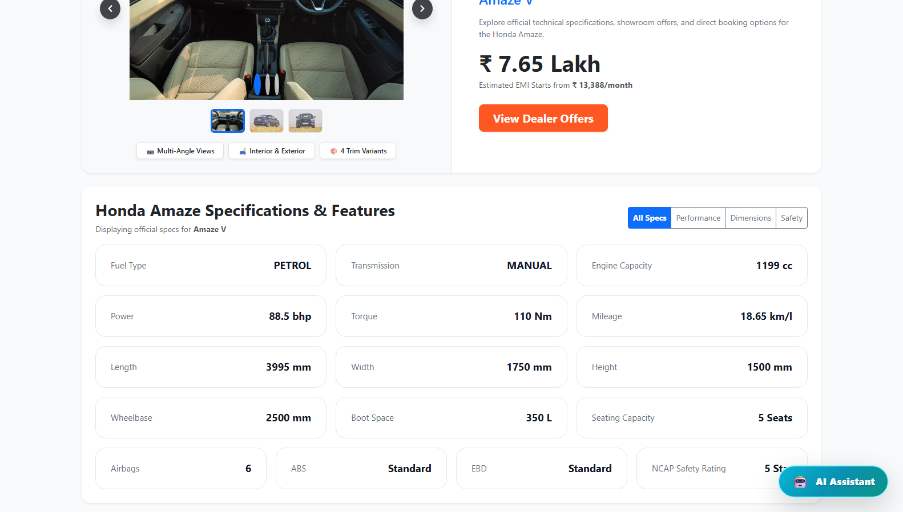
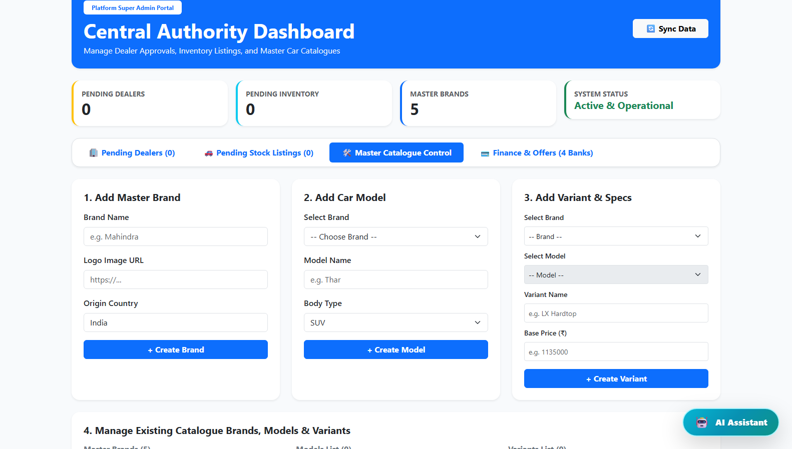
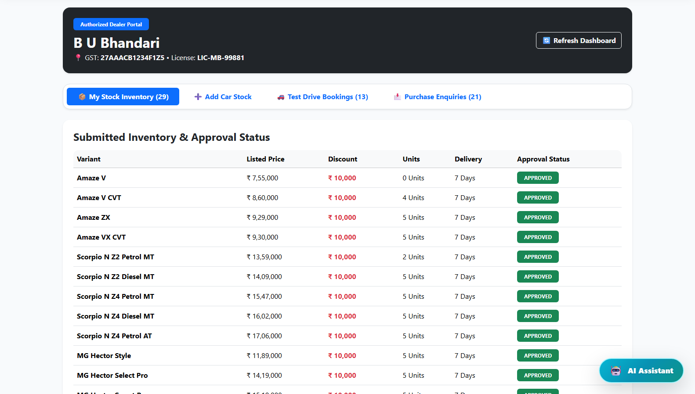
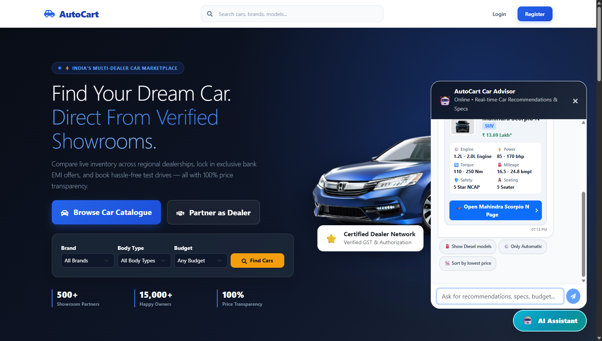

# AutoCart — Microservices Automobile Marketplace & Dealership Platform

AutoCart is a microservices-based automotive e-commerce platform built with Spring Cloud, Spring Boot, MySQL, and React (Vite). It provides role-based workflows for Customers, Showroom Dealers, and Platform Administrators.

### Architecture
AutoCart is split into modular microservices around business domains:
- **`auth-service`** owns users, dealers, admins, authentication, and franchise authorizations.
- **`business-service`** owns the vehicle catalogue, dealer inventory listings, test drive bookings, and dealer ratings.
- **`transaction-service`** owns partner banks, EMI products, card offers, and vehicle purchase enquiries.
- **`ai-service`** provides car recommendations and natural language query processing.
- **`discovery-service`** provides service registration and discovery via Netflix Eureka.
- **`api-gateway`** is the single public entry point routing external requests to services.

---

## Platform Showcase

### 1. Customer Marketplace & Car Catalog (`/`)
*Dynamic hero banner, multi-attribute vehicle search, brand filters, and floating AI assistant.*



### 2. Vehicle Details & Financing / EMI Calculator
*Color selections, detailed technical specifications grid, EMI financing options, and dealer comparisons.*



### 3. Admin Central Authority Dashboard (`/dashboard`)
*Platform KPI statistics, dealer approvals, and catalogue management.*



### 4. Authorized Dealer Portal (`/dealer`)
*Inventory management, live pricing discounts, and test drive booking management.*



### 5. AI Car Advisor
*Conversational assistant providing instant vehicle recommendations, real-time spec cards, and quick-reply suggestion chips.*



---

## 1. Prerequisites

Before running the platform, ensure you have the following installed:
- **Java JDK**: Version 17 or 21
- **Apache Maven**: Version 3.8+
- **Node.js**: Version 18+ (with npm)
- **MySQL Server**: Version 8.0+

---

## 2. Database Setup

AutoCart uses microservice-segregated databases:
- **`autocart_auth`** — User credentials, role RBAC, dealer profiles, and franchise authorizations.
- **`autocart_business`** — Vehicle catalogue, inventory listings, dealer offers, test drive bookings, and dealer reviews.
- **`autocart_transaction`** — Bank partners, EMI loan configurations, card offers, and vehicle purchase enquiries.

Flyway creates empty schemas on startup (`V1__init_auth_schema.sql` for auth, `V1__init_business_schema.sql` and `V2__add_missing_columns.sql` for business, `V1__init_transaction_schema.sql` for transaction). Flyway migrations create table structures only and contain no `INSERT` statements. The three demo accounts are created on first startup by the Initializer classes (`AdminInitializer`, `DealerInitializer`, and `CustomerInitializer`) in `auth-service`, and only when running in the `dev` or `default` Spring profile.

A fresh start has no catalogue, no dealer listings, and no bank offers, so car pages show no dealers. A seed script for the three new databases is still to be written. The script `database/catalogue_data.sql` was written for the old single database, has no dealer listings, users, or dealers, and has fewer variants and images than the tested data, so building from it is not tested.

### Option A: Migrate Existing Single Database (`autocart_db`) — Tested Path
Migrating from an existing populated `autocart_db` is the tested path (tested manually and by API across all roles: purchases, stock changes, ratings, admin and dealer actions):
1. Ensure the populated `autocart_db` and the three target databases (`autocart_auth`, `autocart_business`, `autocart_transaction`) exist:
```bash
mysql -u root -p -e "CREATE DATABASE IF NOT EXISTS autocart_auth CHARACTER SET utf8mb4 COLLATE utf8mb4_0900_ai_ci;"
mysql -u root -p -e "CREATE DATABASE IF NOT EXISTS autocart_business CHARACTER SET utf8mb4 COLLATE utf8mb4_0900_ai_ci;"
mysql -u root -p -e "CREATE DATABASE IF NOT EXISTS autocart_transaction CHARACTER SET utf8mb4 COLLATE utf8mb4_0900_ai_ci;"
```
2. Start `auth-service`, `business-service`, and `transaction-service` once so Flyway builds the tables and the demo accounts appear.
3. Stop all three services.
4. Clear the rows that the first start created in the three target databases with the provided script. It truncates the 18 data tables and does not touch flyway_schema_history. Run it from the repository root:
```bash
mysql -u root -p -e "source database/clear_new_dbs.sql"
```
5. Run `database/split_migration.sql` from the MySQL interactive client without `--force`:
```bash
mysql -u root -p
```
```sql
source database/split_migration.sql;
```
*(Do not run with `mysql ... < file` unless you have confirmed it handles DELIMITER and stops on errors identically; `source` from the MySQL client is the tested way).*
6. Check the verification output at the end of the script to confirm source and target counts are equal.

> [!NOTE]
> `split_migration.sql` includes a pre-flight safety check (`check_empty_targets`) that aborts with an error if any target table already has rows. It copies users and dealers as well as catalogue and transaction data. The source database `autocart_db` is only read and remains completely untouched as a rollback copy.

### Option B: Fresh Setup with Empty Schemas (Not Tested)
Starting with empty databases will initialize tables and demo users, but without catalogue items, dealer inventory, or finance plans:
1. Start local MySQL and create the 3 empty databases (commands shown in step 1 above).
2. Start services to allow Flyway to generate the schema and the Initializer classes to seed demo logins.
3. Loading catalogue data into a fresh setup is not tested.

### Schema Changes
`spring.jpa.hibernate.ddl-auto` is set to `validate` across all services. Any future schema changes require adding a new versioned Flyway migration script (e.g. `V3__...sql`) in the corresponding service's `db/migration` folder; never edit existing `V1` or `V2` migration files.

---

## 3. Environment Variables

Spring Boot does not auto-load `.env` files by default. Set the required variables in your terminal shell or your IDE run configuration:

### Windows (PowerShell):
```powershell
$env:SPRING_DATASOURCE_USERNAME = "root"
$env:SPRING_DATASOURCE_PASSWORD = "your_mysql_password"
$env:JWT_SECRET = "your_strong_jwt_secret_at_least_32_characters_long"
$env:INTERNAL_API_KEY = "your_internal_service_key"

# Optional integrations & overrides:
$env:AUTH_DB_URL = "jdbc:mysql://localhost:3306/autocart_auth"               # Optional override
$env:BUSINESS_DB_URL = "jdbc:mysql://localhost:3306/autocart_business"       # Optional override
$env:TRANSACTION_DB_URL = "jdbc:mysql://localhost:3306/autocart_transaction" # Optional override
$env:ANTHROPIC_API_KEY = "your_anthropic_api_key"                            # Required for AI Chatbot
$env:MAIL_USERNAME = "your_gmail@gmail.com"                                  # Required for Password Reset Emails
$env:MAIL_PASSWORD = "your_gmail_app_password"                              # Required for Password Reset Emails
```

### Linux / macOS (Bash):
```bash
export SPRING_DATASOURCE_USERNAME="root"
export SPRING_DATASOURCE_PASSWORD="your_mysql_password"
export JWT_SECRET="your_strong_jwt_secret_at_least_32_characters_long"
export INTERNAL_API_KEY="your_internal_service_key"

# Optional integrations & overrides:
export AUTH_DB_URL="jdbc:mysql://localhost:3306/autocart_auth"               # Optional override
export BUSINESS_DB_URL="jdbc:mysql://localhost:3306/autocart_business"       # Optional override
export TRANSACTION_DB_URL="jdbc:mysql://localhost:3306/autocart_transaction" # Optional override
export ANTHROPIC_API_KEY="your_anthropic_api_key"                            # Required for AI Chatbot
export MAIL_USERNAME="your_gmail@gmail.com"                                  # Required for Password Reset Emails
export MAIL_PASSWORD="your_gmail_app_password"                              # Required for Password Reset Emails
```

- `INTERNAL_API_KEY`: Shared secret for service-to-service REST calls; must be identical across `auth-service`, `business-service`, and `transaction-service`; fails closed when empty.
- `JWT_SECRET`: 256-bit secret (minimum 32 characters long) used for HMAC-SHA256 signing of JWT authentication tokens.

*(See [.env.example](.env.example) for the full list of configuration properties).*

---

## 4. Microservices Startup Order & Ports

Start each service in a separate terminal window in the specified order. Wait for each service to initialize before starting the next:

| Order | Service | Directory | Port | Readiness Check |
| :---: | :--- | :--- | :---: | :--- |
| **1** | **Discovery Service** | `backend/discovery-service` | `8761` | Open `http://localhost:8761` in browser |
| **2** | **Auth Service** | `backend/auth-service` | `8081` | Registers as `AUTH-SERVICE` in Eureka; seeds demo accounts |
| **3** | **Business Service** | `backend/business-service` | `8082` | Registers as `BUSINESS-SERVICE` in Eureka |
| **4** | **Transaction Service** | `backend/transaction-service` | `8083` | Registers as `TRANSACTION-SERVICE` in Eureka |
| **5** | **AI Service** | `backend/ai-service` | `8084` | Registers as `AI-SERVICE` in Eureka |
| **6** | **API Gateway** | `backend/api-gateway` | `8080` | Listens at `http://localhost:8080`; check `http://localhost:8080/api/brands` returns HTTP 200 (Note: gateway does not route `/api/internal/**`) |
| **7** | **Frontend (Vite UI)**| `frontend/autocart-frontend` | `5173` | Run `npm run dev`; open `http://localhost:5173` |

Command for each backend service:
```bash
mvn spring-boot:run
```

Command for frontend:
```bash
cd frontend/autocart-frontend
npm install
npm run dev
```

---

## 5. Seeded Logins (Demo Only)

The following pre-configured accounts are automatically seeded on first startup by the Initializer classes for demonstration and local testing only:

| Role | Email | Password | Scope |
| :--- | :--- | :--- | :--- |
| **Admin** | `admin@autocart.com` | `admin123` | Platform administration, showroom & inventory approvals |
| **Dealer** | `dealer@bubhandari.com` | `dealer123` | Inventory listings, showroom management, test drives |
| **Customer** | `john.doe@example.com` | `buyer123` | Catalogue browsing, test drive bookings, purchase enquiries |

> [!WARNING]
> These demo credentials are for local development use only and must be changed or removed for any shared or deployed environment.

---

## 6. First Run Walkthrough

> [!IMPORTANT]
> The walkthrough requires catalogue data and dealer listings loaded first; follow the migration steps in Section 2, Option A.

To test the complete end-to-end flow:

1. **Log in as Dealer:**
   - Go to `http://localhost:5173/login` and log in with `dealer@bubhandari.com` / `dealer123`.
   - Navigate to the Dealer Portal inventory section and add a vehicle variant listing to your showroom with unit count, pricing, and discount.
   - Initial listing status will be `approval_status = PENDING`.
2. **Approve as Admin:**
   - Log out and log in with `admin@autocart.com` / `admin123`.
   - Go to the Admin Dashboard inventory tab and click **Approve** on the newly submitted listing.
   - Status updates to `approval_status = APPROVED` and `listing_status = ACTIVE`.
3. **Purchase as Customer:**
   - Log out and log in with `john.doe@example.com` / `buyer123`.
   - Browse the vehicle catalogue, view the approved dealer's offer, select financing/color, and complete the purchase enquiry.
   - The inventory stock automatically decrements, and the order appears in your customer dashboard.

---

## 7. Known Limitations

- **Database Isolation & REST Snapshot Synchronization:** Each microservice strictly owns its own database (`autocart_auth`, `autocart_business`, `autocart_transaction`). There are no cross-database foreign keys. Inter-service data sharing is performed over REST secured by `X-Internal-Token`, and services store snapshot columns (e.g., `customer_name`, `showroom_name`, `car_model_name`) to avoid coupling.
- **No Distributed Transactions:** Cross-service workflows (such as inventory reservation and purchase creation) do not use two-phase commits or distributed transaction coordinators. If a service fails halfway through a purchase or stock change, stock can drift and requires manual correction.
- **Customer Enquiry Cancellation:** Customers cannot cancel their own purchase enquiries once placed; cancellations can only be executed by the dealer or platform admin.
- **In-Memory Rate Limiting:** Login and password-reset attempts are tracked in memory per `auth-service` JVM instance (5 failed attempts per account and IP per 15 minutes, 30 per IP); restarting `auth-service` clears these counters.
- **Automated Test Suites:** Automated unit/integration tests exist only in `auth-service` (`AuthServiceApplicationTests`, `InternalAuthControllerTest`), `business-service` (`BusinessServiceApplicationTests`, `BaseTestcontainersIntegrationTest`, `InternalBusinessControllerTest`), and `transaction-service` (`InternalTransactionControllerTest`). End-to-end regression validation was performed manually and via test scripts.
- **Simulated Payment:** Payment processing at checkout is simulated via mock gateway transaction IDs (`TXN-...`); external payment gateway webhooks (e.g. Razorpay, Stripe) are not integrated.
- **No Seed Script for Split Databases:** An automated seed script for populating fresh split databases from scratch is still to be written.
- **Network Interface Binding:** No `server.address` is configured in `discovery-service`, `auth-service`, `business-service`, `transaction-service`, `ai-service`, or `api-gateway`, so these services listen on all network interfaces (`0.0.0.0`) by default and should be firewalled or bound to localhost outside local development.
